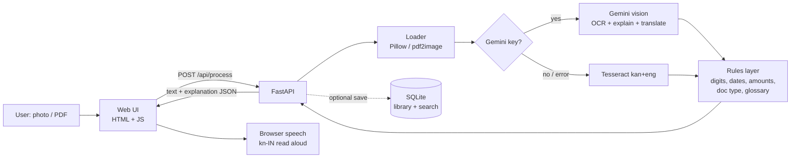

# Architecture

Key design decisions
- Two engines behind one endpoint: AI for quality, Tesseract so the product never fully fails.
- The rules layer runs on every result, so dates, amounts and the glossary are deterministic and testable.
- Privacy by default: nothing is stored unless the user opts in.
